<div align="center">

# Pfm

**Tu dinero y el de tu negocio, en una sola cuenta.**

Finanzas personales y contabilidad de empresa conviviendo bajo el mismo inicio de
sesión: presupuestos, ahorro e informes por un lado; facturación, libros y
calendario DIAN por el otro. Sin que ninguna se meta con la otra.

[](https://openjdk.org/)
[](https://spring.io/projects/spring-boot)
[](https://www.mysql.com/)
[](https://www.thymeleaf.org/)
[](#pruebas)
[](#seguridad)
[](#licencia)

<br>

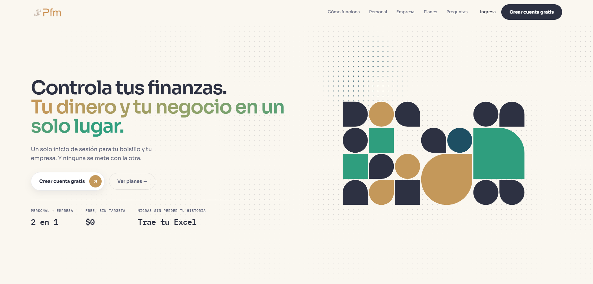

</div>

---

## El problema

Quien tiene un negocio pequeño acaba mezclando la plata del bolsillo con la del
negocio. No por desorden: **porque las herramientas obligan a elegir.** Las
aplicaciones de finanzas personales no saben de IVA ni de retenciones; los
programas contables dan por hecho que ya tienes contador y no te preguntan cómo
vas de gastos este mes. La misma cuenta paga el mercado y al proveedor, y no hay
un sitio donde eso se vea.

Pfm no elige. Es **una cuenta con dos modos**, y se cambia de uno a otro con un
clic desde la barra superior.

---

## Los dos modos

### Modo Personal

Para llevar tu propia plata, sin abrir ninguna empresa.

| | |
|---|---|
| **Cuentas** | Bancarias, efectivo, tarjeta de crédito e inversión, con saldo derivado de sus movimientos |
| **Transacciones** | Ingresos, gastos y transferencias entre cuentas, con categorías y adjuntos |
| **Presupuestos** | Tope mensual por categoría, con barra de avance y aviso al acercarse al límite |
| **Fondos de ahorro** | Bolsas con meta anual, aportes desde tus cuentas y seguimiento mes a mes |
| **Informes** | Evolución mensual, gasto por categoría y comparativas, exportables a CSV, Excel y PDF |
| **Alertas** | Recordatorios de gastos fijos y avisos por correo |
| **Multimoneda** | COP, USD y EUR con conversión y tasa histórica |

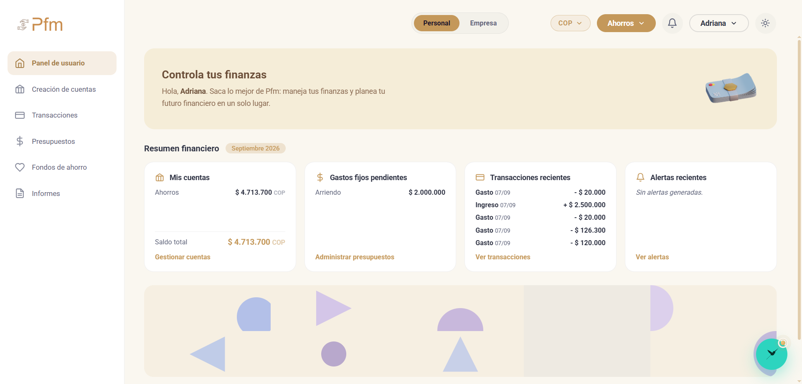

<sub><b>El panel</b> · saldo de la cuenta, los gastos fijos que aún no se han pagado y los últimos movimientos, sin entrar a ninguna pantalla.</sub>

<table>
<tr>
<td width="50%">
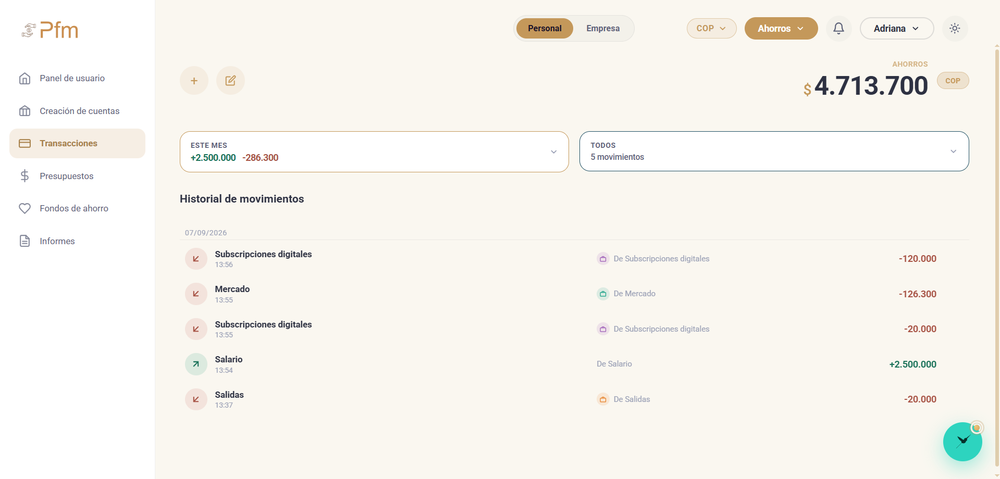
<sub><b>Transacciones</b> · el historial con lo que entra y lo que sale, y el saldo del mes arriba.</sub>
</td>
<td width="50%">
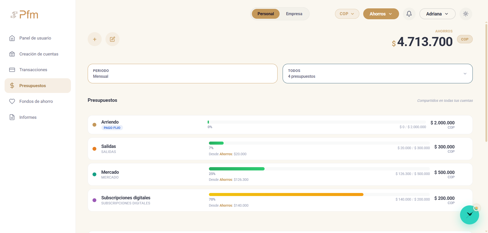
<sub><b>Presupuestos</b> · un tope por categoría; el de suscripciones ya en ámbar al 70%.</sub>
</td>
</tr>
<tr>
<td width="50%">
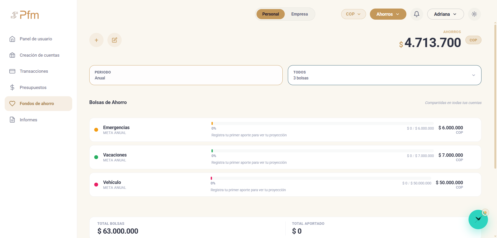
<sub><b>Fondos de ahorro</b> · bolsas con meta anual y su proyección.</sub>
</td>
<td width="50%">
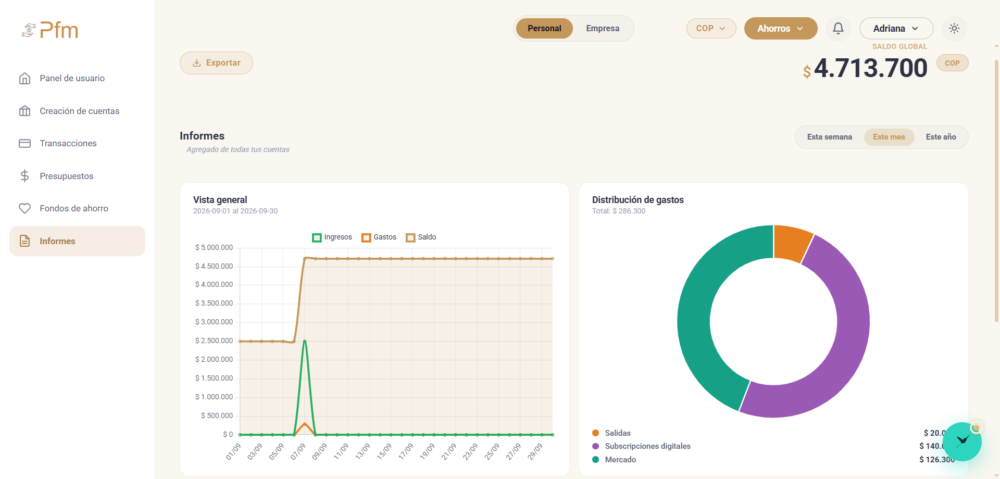
<sub><b>Informes</b> · la evolución del saldo y en qué se fue el dinero. Exportable.</sub>
</td>
</tr>
</table>

### Modo Empresa

Contabilidad completa para una pyme colombiana, con validez fiscal.

| | |
|---|---|
| **Panel** | Caja disponible, ingresos, gastos y utilidad del período, con serie de seis meses |
| **Movimientos** | Ingresos y egresos con IVA, impuesto al consumo y retenciones —también la de IVA— calculados según el régimen del tercero y la fecha del hecho |
| **Facturación** | Emisión y numeración consecutiva, cotizaciones, notas crédito con los conceptos de la DIAN y documento soporte para comprarle a quien no factura |
| **Contabilidad** | Plan de cuentas editable, asientos automáticos y manuales, libros y balance de prueba |
| **Salud contable** | Seis comprobaciones cruzadas que dicen cuál no cuadra, **por cuánto** y dónde se arregla |
| **DIAN** | Calendario de vencimientos que se mueve con el dígito del NIT; borradores de los formularios 300 (IVA), 310 (impuesto al consumo) y 2593 (anticipo del Régimen Simple), el cierre del año del Simple, retenciones y exógena |
| **Inventario** | Catálogo con costo y existencias, y kardex valorizado |
| **Activos fijos** | Alta, depreciación y baja, con el IVA de la compra como mayor valor o como descuento en renta |
| **Nómina** | Liquidación con sus aportes, provisiones y retención, con el salario mínimo, el auxilio y la UVT del año del período |
| **Cierres** | Mensual —con carpeta lista para el contador— y anual |
| **Terceros** | Clientes y proveedores con su régimen y su documento |
| **Colaboradores** | Seis roles: propietario, contador, auxiliar contable, revisor fiscal, socio en solo lectura y vendedora del local |
| **Local compartido** | Varios negocios, cada uno con su NIT, venden en un mismo local: caja única, mercancía en consignación, liquidación con la comisión del local y factura en mandato. El local vende también lo suyo |
| **Activos digitales** | Trazabilidad de cripto con score de origen de fondos |

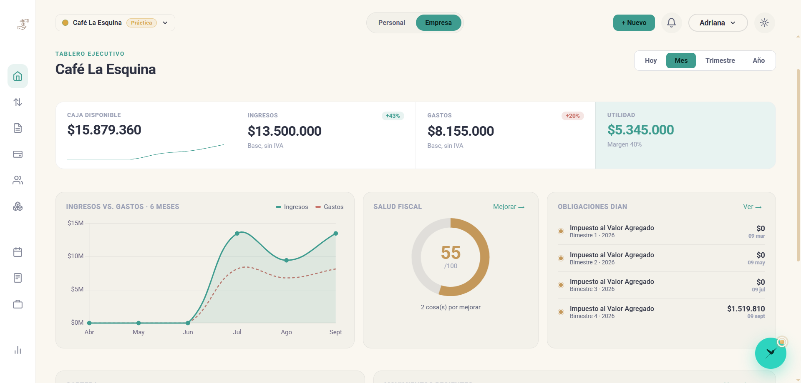

<sub><b>El tablero ejecutivo</b> · caja, ingresos, gastos y utilidad con su margen; la serie de seis meses, la salud fiscal y los vencimientos que vienen, en una pantalla.</sub>

<table>
<tr>
<td width="50%">
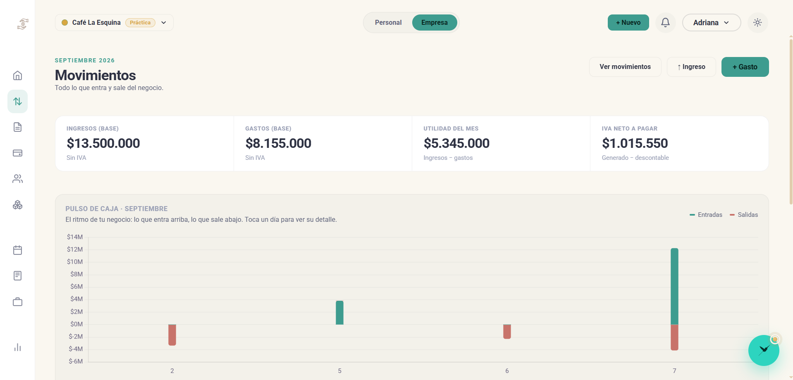
<sub><b>Movimientos</b> · el IVA neto ya calculado, y el pulso de caja día a día.</sub>
</td>
<td width="50%">
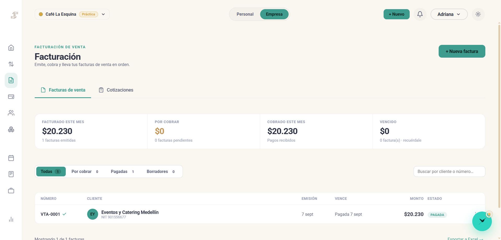
<sub><b>Facturación</b> · numeración consecutiva, cliente con su NIT y estado de cobro.</sub>
</td>
</tr>
<tr>
<td width="50%">
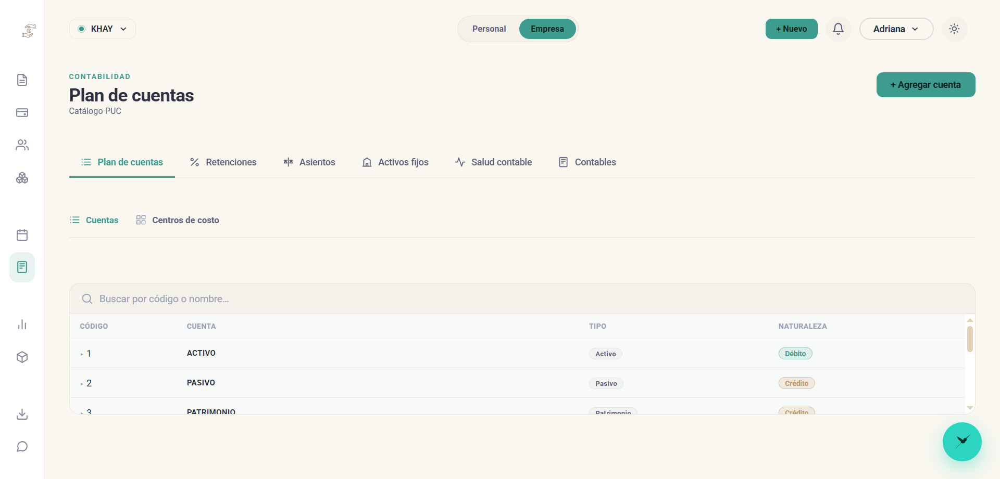
<sub><b>Contabilidad</b> · el plan de cuentas sobre el PUC, con asientos, retenciones y activos fijos.</sub>
</td>
<td width="50%">
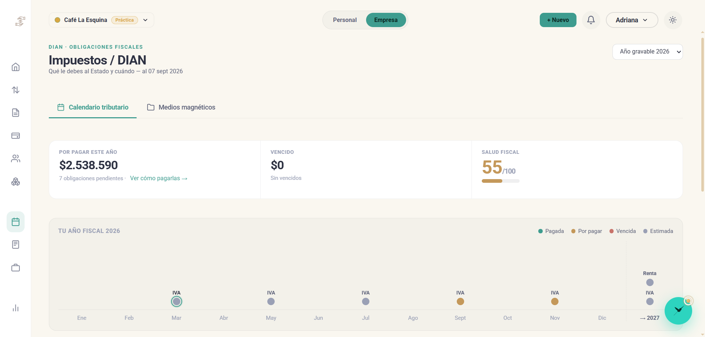
<sub><b>DIAN</b> · qué se debe, cuándo vence y qué ya está pagado, en todo el año.</sub>
</td>
</tr>
</table>

> Las capturas del Modo Empresa usan la **empresa de práctica** que trae el propio
> producto —de ahí la etiqueta *Práctica* junto al nombre—. Viene sembrada con
> datos de ejemplo para que se pueda probar la contabilidad sin arriesgar una
> empresa real.

### Lo que une a los dos

- **Capi**, un asistente que acompaña ambos modos y responde sobre tus propios datos.
- **Aislamiento por diseño.** Un colaborador ve la empresa a la que lo invitaste y
  nada más: nunca las finanzas personales de nadie. Hay pruebas dedicadas a que
  esa frontera no se mueva.
- **Enlace de auditor.** Una vista de solo lectura para el contador, con **token
  expirable y sin necesidad de cuenta**.

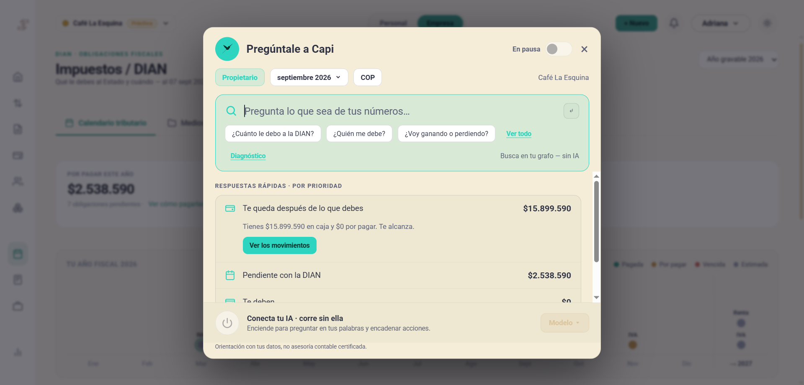

<sub><b>Capi</b> · responde con tus propias cifras —lo que queda en caja después de lo que debes, lo pendiente con la DIAN— y <b>funciona sin conectar ninguna IA</b>: busca en tus datos. Conectar un modelo solo añade preguntarle en tus palabras.</sub>

---

## Vienes de Excel

Cambiar de herramienta no debería costar la historia. Se importan cuatro cosas:

| | |
|---|---|
| **Clientes y proveedores** | Nombre, NIT y contacto |
| **Movimientos** | Ingresos y egresos con su fecha, valor e IVA |
| **Saldos iniciales** | El balance con el que llegas: caja, cartera, deudas y patrimonio |
| **Inventario** | Catálogo con costo y existencias |

Tú emparejas las columnas —nada se adivina cuando adivinar cambiaría un número—,
la importación dice **qué fila no pudo leer y por qué**, y si aun así sale mal,
**se deshace**.

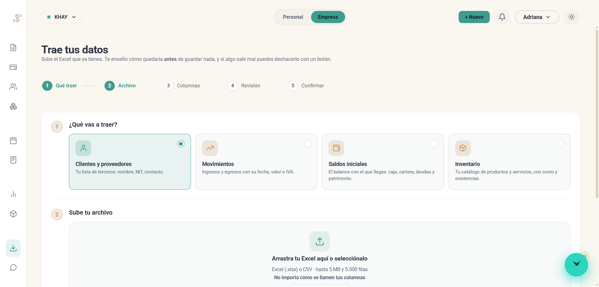

<sub>Cinco pasos, y el tercero es <b>tuyo</b>: emparejar las columnas. Nada se adivina cuando adivinar cambiaría un número.</sub>

---

## PFM Cnota

**Las cuentas del negocio del cuaderno, desde el celular.**

Pfm le sirve a quien ya lleva cuentas. Cnota es para quien todavía las lleva en
un cuaderno, o de memoria: la persona que teje, cultiva, cocina o vende en una
feria y necesita saber **cuánto le quedó**, no aprender contabilidad. Es una
aplicación aparte, hermana de Pfm, que se instala desde el navegador y
**funciona sin señal**.

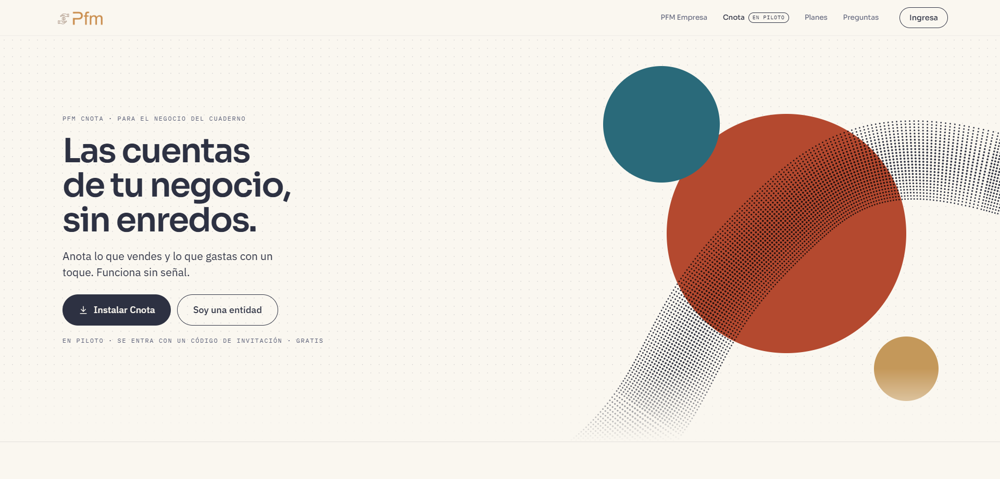

<sub><b>PFM Cnota</b> · en piloto. Se entra con un código de invitación y es gratis.</sub>

### Lo que hace

| | |
|---|---|
| **Vendí y Gasté** | Dos botones. Una venta se anota tocando el producto; un gasto, escogiendo en qué fue y cuánto |
| **Fiado** | Quién quedó debiendo y cuánto, y «Me pagó» cuando abona. Se puede fiar solo una parte de la venta. Lo mismo con lo que el negocio debe a sus proveedores |
| **Productos y servicios** | Un producto se vende por unidad o por medida (libra, kilo, litro, metro), con su código si lo tiene. Un servicio se cobra por persona, por hora o a precio fijo, como un taller o un plan mensual |
| **Lo que tengo** | A cada producto se le puede llevar la cuenta de cuántos quedan: baja sola al vender y avisa cuando se está acabando. Es opcional y nunca impide una venta |
| **Descuentos y promociones** | Un descuento en la venta, por pieza o sobre el total, en porcentaje o en pesos. O una promoción del producto hasta una fecha, que se aplica sola y se acaba sola |
| **Para qué fue el gasto** | Un gasto puede ir «para» un producto, y la app dice cuánto se le ha gastado y si ya se recuperó |
| **Hoy** | Cómo va el mes —o el día—: lo vendido, lo gastado y lo que queda |
| **Informes** | Por día, semana, mes o año, con lo que más se vendió y lo que más se compró. Un panel compara con el periodo anterior y muestra el mejor día, cómo pagaron y lo que hay por cobrar |
| **Copia de seguridad** | Las cuentas se guardan en un archivo y se recuperan en otro celular |

La bienvenida pregunta a qué se dedica la persona y con eso arma la app: las
medidas que ofrece, las categorías de gasto y el aspecto. No hay nada que
configurar.

### Cómo se conecta con Pfm

Cnota está pensada como la puerta de entrada: lo que la persona anota en
lenguaje llano —«vendí», «gasté», «me quedó debiendo»— Pfm lo recibe y lo
convierte en asientos contables, para que una entidad de apoyo o un contador
vean cuentas en regla sin que nadie haya tenido que aprender el PUC.

- **El lado de Pfm está construido**: el alta por invitación, la recepción de lo
  anotado y la entrada desde un segundo celular, con su contrato documentado.
- **En el piloto la app corre sola.** Mientras Pfm no esté desplegado, Cnota se
  publica sin servidor: todo lo anotado **se queda en el celular** y no sale de
  él. Lo pendiente por enviar queda en cola para cuando haya a dónde.
- **Ensayado de punta a punta en local.** Un celular con 500 productos y 610
  anotaciones sin enviar se conectó por primera vez: todo subió, bajó idéntico a
  un segundo celular y reenviarlo no duplicó nada.
- **Lo que falta**: desplegar Pfm, encender la conexión y que un contador revise
  la correspondencia entre lo que se anota y las cuentas contables.

### Por dentro

Es una PWA con Vite y Preact que guarda en IndexedDB y se sirve como archivos
estáticos. Lleva **294 pruebas** propias
(Vitest) y, antes de cada publicación, un revisor que la detiene si el paquete
trae mapas de código, rutas del equipo, claves o rastros de Pfm.

---

## Planes

Al registrarte entras con **30 días de Pro incluidos**. Al terminar, la cuenta
vuelve a Free automáticamente y no se cobra nada.

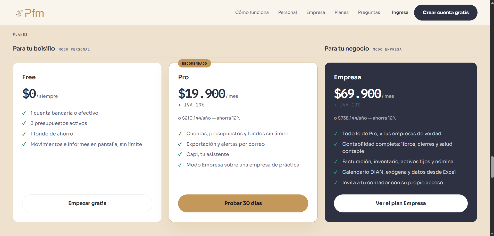

| | **Free** | **Pro** | **Empresa** |
|---|---|---|---|
| Precio | $0, sin caducidad | $19.900 COP/mes | $69.900 COP/mes |
| Cuentas · presupuestos · fondos | 1 · 3 · 1 | Sin límite | Sin límite |
| Informes en pantalla | Sí | Sí | Sí |
| Exportación y alertas por correo | — | Sí | Sí |
| Capi | — | Sí | Sí |
| Modo Empresa | — | Sobre una **empresa de práctica** | Sobre **tu empresa real** |
| Invitar a tu contador | — | — | Sí |

Un **local compartido** paga el plan Empresa más un complemento por cada negocio
que tiene en custodia; el cobro lo muestra línea por línea.

> **Degradar no es despojar.** Si dejas de pagar, no se borra nada: la cuenta
> vuelve a Free y la empresa pasa a **solo lectura**. La sigues viendo entera y
> puedes exportar tus libros, tu inventario y tus movimientos. Lo que no puedes
> es seguir registrando hasta reactivar el plan.

Los precios se leen de la configuración en un único sitio, así que la página de
planes, el cobro y los datos estructurados del buscador **no pueden decir cifras
distintas**.

---

## Stack

| Capa | Tecnología |
|---|---|
| Lenguaje | Java 17 |
| Framework | Spring Boot 3.5.16 — Web, Data JPA, Security, Validation, Mail |
| Vistas | Thymeleaf 3.1 con `thymeleaf-extras-springsecurity6` |
| Base de datos | MySQL 8 |
| Documentos | Apache PDFBox · Apache POI |
| Construcción | Maven (wrapper incluido) |

Sin framework de front: HTML, CSS y JavaScript sin librerías. Las maquetas del
sitio público son HTML y CSS, no imágenes — pesan cero, se ven nítidas en
cualquier pantalla y no envejecen cuando la aplicación cambia.

### Dimensiones

| | |
|---|---|
| Código Java | ~65.500 líneas en 527 clases |
| Entidades | 72 |
| Servicios | 90 |
| Plantillas | 129 |
| Endpoints HTTP | 310 |
| Código de pruebas | ~46.300 líneas en 161 clases |
| Pruebas | **1.639** |

---

## Decisiones de diseño que vale la pena conocer

**El balance no se guarda: se deriva.** Sale de los asientos cada vez que se
pide, así que no existe el saldo desactualizado que hay que recalcular. Cuadra
por construcción.

**Una sola puerta por regla.** Quién entra al Modo Empresa se decide en un único
método. La regla llegó a estar escrita en tres sitios y el desajuste dejó entrar
al panel personal bajo el cromo de empresa; desde entonces, una regla, un sitio.

**Ninguna heurística decide sola algo que cambie un número.** En la importación,
una columna llamada «Valor» puede ser base o puede llevar el IVA dentro: las dos
lecturas dan cifras creíbles y una está mal en un 19%. Se pregunta.

**Salud contable no puntúa: señala.** No da una nota sobre 100 —que no se puede
accionar— sino la comprobación que falla, la diferencia exacta y el enlace a la
pantalla donde se arregla.

**Las cifras de la ley tienen fecha.** La UVT, el salario mínimo y el auxilio de
transporte se guardan por año, y las tarifas y cuantías mínimas con su vigencia.
Cada cálculo usa las de la fecha del hecho: una retención de 2025 registrada hoy
sale con la UVT de 2025. Cuando el Consejo de Estado suspende un decreto, es una
fila nueva, no un cambio de código. Un registro normativo versionado junto al
código dice, de cada cifra, qué norma la fija, dónde vive y qué prueba la cuida.

**El esquema se versiona a mano y es idempotente.** `ddl-auto` está en `none`.
Cada migración vive en `database/schema.sql` y puede volver a ejecutarse sin
romper nada.

---

## Pruebas

**1.639 pruebas, todas verdes con `clean`** — unas 46.300 líneas de código de
prueba para 65.500 de producción.

No son 1.639 comprobaciones de que un método devuelve lo que devuelve. Hay tres
familias, y cada una nació de un fallo real que la anterior no habría cogido.

### 1 · Lo que solo se ve mirando

Un defecto visual no rompe nada, así que ninguna prueba de dominio lo nota. **O se
fija con una prueba, o vuelve.**

| Prueba | Qué impide |
|---|---|
| `AislamientoPersonalTest` · `FronteraEntreModosTest` | Que un colaborador alcance datos personales, o que un modo pinte los del otro |
| `InvariantesPlanTest` | Que la escalera de planes se rompa y un plan superior pierda lo que ya tenía |
| `PagoIdempotenteTest` | Que un pago repetido cobre dos veces |
| `PlantillasSanasTest` | Comentarios mal cerrados y `confirm()` del navegador |
| `SeoTest` | Canónica que ignora la cabecera `Host`, JSON-LD válido y precios que no se duplican |
| `ContrasteAaTest` | Que un cambio de color deje texto por debajo del mínimo legible |
| `LandingComprobadoTest` | Anclas rotas, imágenes sin `alt`, títulos repetidos |
| `LogotipoSinDeformarTest` · `BarraSuperiorTest` | Dos defectos visuales reales que llegaron a producirse y no rompían nada |
| `ConfiguracionProduccionTest` | Que algo pensado para desarrollo se cuele en producción |

### 2 · Uso real, apartado por apartado

**236 casos** que recorren la aplicación *como la usa alguien*, con usuarios
desechables y por los mismos formularios que envía el navegador. Los 23 apartados
de los dos modos, más 13 recorridos completos.

Los casos se ordenan por **probabilidad de que un usuario llegue ahí**: lo que
hace todo el mundo, el uso normal, **el usuario que se equivoca** —la banda que
más defectos entrega— y lo raro pero grave.

Encontró siete defectos que las 1.085 pruebas de entonces no veían, entre ellos un
formato de moneda que **cambiaba según la máquina donde corriera el servidor** y
un mensaje técnico de la base de datos que llegaba a la pantalla del usuario.

### 3 · Seguridad, por clase de vulnerabilidad

<a name="seguridad"></a>Una campana distinta: no *dónde llega un usuario* sino
**por dónde entra un atacante**, ordenada por la prevalencia real del **OWASP
Top 10**.

| | Qué se comprueba |
|---|---|
| `PostsExigenCsrfTest` | Que las ~150 rutas que escriben **exijan su token**, y que ninguna atienda a un anónimo |
| `AislamientoEntreEmpresasTest` | Que una empresa no vea a otra, ni por pantalla, ni por sesión forzada, ni por export |
| `RecursosHijosAcotadosTest` | Que un soporte o una factura no se sirvan por su id a secas |
| `NadaSeInyectaEnLaPantallaTest` | XSS, en las 129 plantillas y en lo que devuelve el servidor |
| `CadenasDeAtaqueTest` | Siete cadenas completas: escalada de rol, robo de sesión, plan vencido |
| `NadaSensibleSeEscapaTest` | Que una contraseña no acabe nunca en el archivo de registro |
| `FormularioNoPrometeMasQueLaEntidadTest` | Que ningún formulario acepte más de lo que la base aguanta |

El proyecto pasó por un **proceso de refuerzo guiado por el OWASP Top 10**:
revisión capa por capa —configuración, controladores, servicios, repositorios,
plantillas y JavaScript—, pruebas dirigidas por clase de vulnerabilidad, y
cadenas de ataque que encadenan pasos que por separado no son nada.

Las dependencias se auditan con **OWASP dependency-check** contra la base del
NVD, y se mantienen al día: el trabajo de refuerzo incluyó actualizar el
framework, el servidor de aplicaciones y las bibliotecas de documentos.

### Y antes de cerrar una línea de trabajo, un recorrido

Una prueba la recorre de punta a punta **contra una copia de la base real** —se
niega a correr en otra— con cada cifra calculada a mano: 113 casos el local
compartido y 67 el Hito Fiscal. Lo que todavía no cumple la norma no cuenta
como falla: queda como sonda, con cifras, para decidir qué va primero.

---

## Puesta en marcha

Requisitos: **JDK 17** y **MySQL 8**.

```bash
# 1 · Base de datos
mysql -u TU_USUARIO -p < database/schema.sql

# 2 · Configuración local
cp src/main/resources/application.properties.example \
   src/main/resources/application.properties
#    …y edítalo con tus credenciales.

# 3 · Arrancar
./mvnw spring-boot:run          # http://localhost:8080

# 4 · Pruebas
./mvnw clean test
```

> `src/main/resources/application.properties` **no se versiona**: lleva
> credenciales. El fichero `.example` documenta cada clave que hace falta.

---

## Estado

**MVP aprobado en la sustentación, auditado y endurecido.** En ensayo de
despliegue. Desde entonces el trabajo es producto: el local compartido y el Hito
Fiscal salieron de conversaciones con microempresarios.

**Construido**

- Modo Personal y Modo Empresa, ambos operativos
- Los tres planes, con su cobro y su degradación
- Migración desde Excel de punta a punta
- Capi
- Local compartido: caja de varios negocios, consignación, liquidación y factura en mandato
- Hito Fiscal: notas crédito, documento soporte, Régimen Simple, retención de IVA,
  impuesto al consumo (formulario 310) e IVA de los activos fijos
- Las cifras legales de cada año, con su registro normativo
- Sitio público: mensaje, planes, preguntas, páginas legales y SEO técnico
- PFM Cnota: la aplicación del celular (versión 0.13, en piloto cerrado por invitación)
  y su lado en Pfm

**Verificado**

- **Auditoría de uso** — 23 apartados y 13 recorridos, 236 casos. Los siete
  defectos que encontró, corregidos con su prueba.
- **Refuerzo de seguridad** — revisión por capa de código y pruebas por clase de
  vulnerabilidad, guiadas por el OWASP Top 10. Dependencias auditadas y al día.
- **Ensayo con el perfil de producción** — arranque, recorrido completo y
  configuración real verificados contra una base aparte.
- **Restauración de la copia de seguridad** — la base reconstruida desde cero
  solo con el respaldo: 52 tablas y 1.378 filas, todas coincidentes.
- **Recorridos contra una copia de la base** — el local compartido (113 casos) y
  el Hito Fiscal (67), todos bien.

**Pendiente**

- Ensayo con HTTPS, para cerrar lo que sin TLS no puede probarse
- Conectar PFM Cnota con Pfm una vez desplegado, y la revisión de sus cuentas por un contador
- Verificación de correo antes del período de prueba
- Facturación electrónica con un proveedor tecnológico autorizado: hoy la factura
  sale como comprobante interno, sin CUFE

---

## Licencia

**Software propietario. Todos los derechos reservados.**

Copyright © 2026 Rubén Agudelo Alzate.

Este repositorio se publica con fines de **consulta y evaluación**. No se concede
licencia para usar, copiar, modificar, distribuir ni explotar comercialmente el
software ni ninguna parte de él. El texto completo y vinculante está en
[`LICENSE`](LICENSE).

Las bibliotecas de terceros conservan sus propias licencias, y ninguna de las
condiciones de arriba pretende alterarlas.

---

<div align="center">
<sub>Hecho en Colombia.</sub>
</div>
